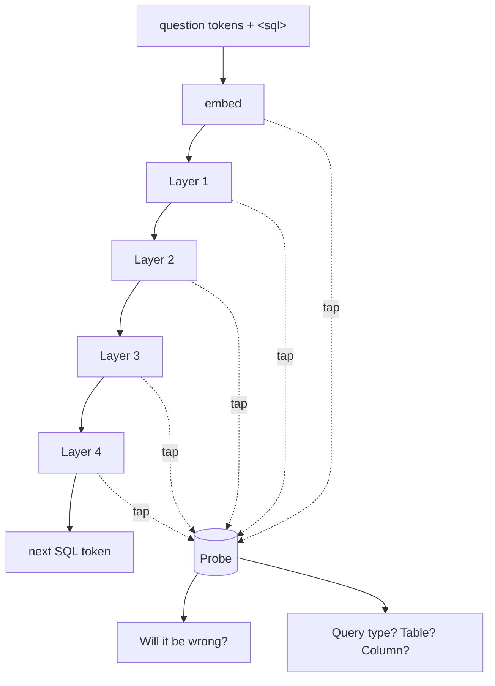

# SQL Confidence Checker — layer probe (MVP)

**Question:** when a model turns English into SQL, can we tell from the inside — layer by layer — when it is *guessing*?

**Short answer:** yes, partly. The plan for the query (what kind, which table) is formed in the first layer. A probe on the layers flags likely mistakes **before any SQL is written** (AUROC 0.86). But the model's own token confidence **after** writing is the better alarm (0.91) — and both miss the worst case: the model is often **confidently wrong** on words it has never seen.

---

## 1. What we built

```mermaid
flowchart LR
    A[English question<br/>'how many staff have pay above 4 2 0 0'] --> B[Tiny transformer<br/>4 layers, trained here]
    B --> C[SQL<br/>SELECT COUNT ( * ) FROM employees<br/>WHERE salary > 4 2 0 0]
    C --> D{Run on SQLite<br/>vs. correct SQL}
    D --> E[Label: right / wrong]
    B -. read every layer .-> F[Probes<br/>'will this be wrong?'<br/>'what is it planning?']
    E --> F
    C -. token probabilities .-> G[Output confidence]
    E --> G
    F --> H[Compare: which signal<br/>catches mistakes best?]
    G --> H
```

- **Data:** synthetic text-to-SQL over 3 tables (employees, orders, products). Every test question is tagged by difficulty:

| Slice | What it tests | Example |
|---|---|---|
| Simple | common wording, 1 condition | *list the name of items with cost less than 6 4 1 0* |
| 2–3 conditions | more to copy and combine | *… with age less than 7 1 4 7 and pay less than 4 9 3 3 and city is seattle* |
| Rare synonym | word seen in ~1% of training | *how many staff have age **beneath** 3 3* |
| Never-seen word | word the model has never seen — it **must** guess | *… with quantity **north of** 3 4 3 8* |

- **Model:** a small GPT-style transformer (64 wide, 4 layers, 4 heads) written from scratch in numpy, trained on 12k examples. We froze it at step 1,000 so it still makes real mistakes on familiar wording (84% right overall).
- **Test:** 2,800 fresh questions. "Right" = exact match with the correct SQL.

## 2. Where we looked inside



At the `<sql>` token the model has read the whole question but written nothing. We read the internal state at each layer there and trained simple classifiers (logistic regression, 5-fold cross-validation) to answer two things: *will this query be wrong?* and *what is it about to write?* We also used a **logit lens** — reading each layer as if it were the last — to see how sure each layer is about each token it ends up writing.

## 3. What we predicted vs. what happened

| # | Prediction | Result |
|---|---|---|
| 1 | The plan (query type, table) shows up in early layers | ✅ **True.** Query type is 99.6% readable by Layer 1. Table is 83% by Layer 1 → 88% by Layer 4. |
| 2 | Deeper layers "know" the query will be wrong before writing it | 🟡 **Partly.** Probe AUROC rises 0.80 → 0.86 from embedding to Layer 3–4 (familiar words). Real signal beyond question length (0.73) — but weaker than output confidence. |
| 3 | When guessing, the model is less confident | 🟡 **Mostly.** Output confidence catches most errors (AUROC 0.91). But **29% of wrong queries were written with >90% confidence on every token.** |
| 4 | The guess is visible layer by layer | ✅ **True.** On wrong queries, the weakest token's confidence stalls: 54% vs 83% at Layer 3, 70% vs 96% at the last layer. |

### Charts


*Top: a correct query — every token locks in by Layer 2–3. Bottom: "north of" was never seen; the model wrote `<` instead of `>` at 100% confidence. This is the dangerous case: a confident guess.*


## 4. Simplified analytics — what we learned

| Metric | Value |
|---|---|
| Overall accuracy | **84%** (simple 98%, 2–3 conditions 86%, rare synonym 96%, never-seen word 51%) |
| #1 cause of mistakes | picking the **wrong column** (169 of 444 errors), then **copying a number wrong** (142), then **flipping > / <** (73) |
| Best "is it wrong?" signal | **output confidence** after writing — AUROC **0.91** |
| Layer probe before writing | AUROC **0.86** on familiar words, **0.72** overall |
| Question length alone | AUROC 0.73 (so the layers add real signal) |
| Review the 20% least-confident queries | catches **72%** of all mistakes |
| Auto-run only the 70% most-confident | accuracy goes **84% → 97%** |
| Confidently wrong | **29%** of mistakes — mostly unknown words; only 67% of those errors get flagged |

**In plain terms**

1. **The model decides *what kind* of query early, and *which column* late — and the column is where it fails.** The column choice is only ~62% readable inside the model before writing, and it's the #1 error.
2. **Its confidence is a usable alarm.** Send the least-sure 20–30% to a human and the rest is ~95–97% right.
3. **Unknown words are the blind spot.** When the model doesn't understand a word, it often fills the gap with a confident default instead of hesitating. A checker needs a separate "did it understand every word?" test, not just confidence.
4. **Reading the layers before writing is a cheap early warning, not a replacement.** It's useful to stop a bad query before generation (saves time), but the final call should combine it with output confidence.

## 5. Honest limits

- Tiny model on a synthetic task — the *method* carries over; the exact numbers won't.
- HuggingFace was blocked here, so no pretrained model was tested. `colab_real_model.py` runs the same probe on Qwen2.5-0.5B in a free Colab/Kaggle notebook. **It has not been run yet.**
- The checkpoint (step 1,000) was chosen to leave real errors; a fully trained version scores ~100% on familiar wording, leaving only unknown-word errors.

## 6. Files & how to rerun

| File | What it does |
|---|---|
| `data.py` | question/SQL generator, difficulty slices, SQLite check |
| `model.py` | numpy transformer (forward + backward, gradient-checked) |
| `train.py` | trains, saves checkpoints to `ckpt/` |
| `probe.py` | runs the test, probes every layer, writes `results/results.json` + `figures/` |
| `colab_real_model.py` | same probe on a real pretrained model (needs GPU notebook) |
| `results/results.json` | every number in this README |

```bash
pip install numpy scikit-learn matplotlib
python train.py 4000            # stop it after the step-1000 checkpoint (~6 min on a laptop CPU)
python probe.py ckpt/step1000.pkl   # or use the included ckpt/model.pkl to reproduce these exact numbers
```
